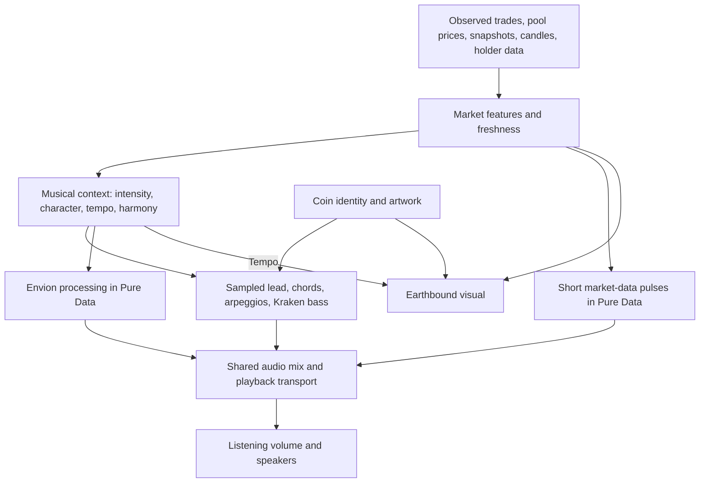

# UPIC audio, visual, and market engine map

Source review: 23 October 2026. This describes the current main player, including the Earthbound visual loop change. It is a starting point for redesigning the audio; the audio implementation has not been changed by this review.

## The current connection

The visual receives interpreted market state, coin identity/artwork, and playback state. It does **not** read the rendered audio waveform in the current Earthbound path. Its `event`, `pulse`, and `piano` callbacks are empty. Audio analysers and note callbacks exist in the app, but they currently do not change the visual's marks.

## 1. How market data becomes a score

`app.js` selects the current source: decoded exchange trades or on-chain swaps when available, pool activity and price observations, or provider snapshots/trade polling. Duplicate trades are rejected. Historical replay uses its recorded observations or candles; candle volume is an aggregate proxy, not an invented sequence of real trades.

The raw live features use short rolling windows:

- Trade rate and observed USD volume: the previous 30 seconds of decoded trades.
- Pool activity: a 10-second window when only pool events are available.
- Buy share: decoded buy/sell observations, exchange order-book balance, or snapshot counts according to availability.
- Liquidity: a separately aged pool snapshot or exchange depth. Missing/stale depth is not held indefinitely.
- Recent activity: an envelope that cools after trading stops.
- Freshness: decoded feeds and snapshot age are tracked separately. A healthy quiet feed differs from stale data.

`market-state.js` adds fixed historical context: returns across several windows, unusual moves, turnover, and volume relative to its recent baseline. Chart zoom/pan do not affect this interpretation.

`music-context.js` then derives musical intensity from absolute and relative movement, market size, and freshness. Its normal context tempo is `40 + 100 × sqrt(intensity)` BPM. Harmonic character also considers trend consistency, volatility, volume ratio, direction, and recent movement. The coin seed chooses a stable tonic; price movement does not continuously detune ringing notes.

## 2. What actually makes sound

| Part | Current role | Main controls |
| --- | --- | --- |
| Sampled instrument engine (`trade-piano.js`) | A seeded GeneralUser lead, scored chords/arpeggios, dedicated Earthbound Kraken bass | Coin seed, harmonic context, tempo, market cap, current activity, replay position |
| Composition (`market-composition.js`) | Four-beat bars, chord voicing, seeded melodic contours, groove and bass patterns, longer phrase development | Character, up/down group, intensity, activity, cap, seed, optional motif |
| Envion (`envion.js`, `envion-market.js`) | Sample/material processing, grains, filters, echo, space, stereo movement | Activity, intensity/imbalance expression, volume, liquidity, direction, tempo |
| Data sonification (`data-sonification.js`) | Short pitched/noisy events from actual trades, changed price observations, or eligible replay observations | Event onset, intensity, activity, pressure, motion, liquidity, balance |
| Optional arpeggio model (`ai-instruments.js`) | A generated/cached motif can supplement the seeded fallback | Seed and harmonic context; playback works without the model |

The file name “trade-piano” is historical: this engine can play strings, flute, organ, synth leads and other assigned instruments, not just piano. The lead's available samples come from GeneralUser; the dedicated bass loads the Kraken Earthbound sample banks.

Five additional math voices are bundled in the Pure Data patch. The current main app resets their gates and levels to zero, and its active conductor only manages the Envion melody level. They should not be counted as five active music layers without checking the actual routing and controls.

### Scheduling and mix

The browser updates musical controls on a nominal 150 ms loop, with additional updates on observations. This does not mean notes are timed only every 150 ms: the sampled engine checks its score every 25 ms and schedules about 250 ms ahead against `AudioContext.currentTime`. It caches composed bars and does not restart a phrase on every market update. Envion's sixteenth-note clock runs inside the Pure Data audio worklet.

Sampled audio and Pure Data join a shared instrument bus, then pass through master gain, a compressor, the vinyl playback/stop transport, and finally listening volume. Several separate gain scales, effects and local limits precede that shared stage. The sampled engine alone has a long convolution room; Envion and the data pulse voice also have space/reverb processing.

## 3. What the same data does visually

| Input | Audible effect | Current Earthbound visual effect |
| --- | --- | --- |
| Coin identity | Stable key, instrument assignment, seeded motif choices | Stable two-layer pattern identity and artwork mask |
| Tempo | Score pace and Envion timing | Motion-clock speed |
| Trade/activity/volume | Activity gating, groove/intensity, data onsets, Envion density and effects | Pattern activity; no individual trade or note callback animation |
| Market cap | Contributes to intensity, harmony/groove context and instrument resonance | Artwork colour transition at the existing $50M threshold |
| Liquidity/depth | Space, damping, duration and texture where available | Mark size, through a logarithmic mapping |
| Holder population | Not a direct note-per-holder mapping | Represented mark count, capped at 10,000 |
| Latest cap direction | Harmonic context comes from broader movement interpretation | Morph between dot/plus/cross states; selected resolved glyphs receive directional colour |
| Freshness / play-pause | Stops new attacks and fades output appropriately | Visibility/ink envelopes, stale release and motion/coast state |

The visual integration still calculates a market-cap identity-reveal value, but the active October 7 renderer uses a fixed artwork blend of `0.7` when artwork is present. The computed identity value is not currently consumed by that adapter. This is an example of an apparent connection in the integration code that does not reach the active renderer.

## 4. What “in sync” currently means

Both engines use the same market interpretation and play/pause/replay state. They are not currently locked to one shared live beat phase. The visual integrates its own animation clock at `1.35 × tempo / 100`; sampled notes use Web Audio time and Envion has an audio-thread clock. Similar energy and tempo therefore do not guarantee that a visible mark lands on a note onset.

The seamless Earthbound cycle is **24 units of the visual clock**. With a steady live tempo, its wall-clock duration is `24 / (1.35 × BPM / 100)` seconds, about 17.78 seconds at 100 BPM. Palette phases use whole cycles, scroll follows a closed orbit, metadata envelopes return smoothly, and noise samples a circular path. Frozen inputs therefore return to the same pixels. Live market changes, transport fades, newly loaded artwork and direction morphs can intentionally change the result between cycles. This is a loop in the procedural layer, not a promise that a changing market repeats.

## 5. Redesign implications

The strongest starting point is one explicit musical score and a shared audio clock. Let market observations change a small set of understandable controls—energy, density, tension, direction and space—then let the composition engine turn those controls into phrases. Emit scheduled musical events with onset time, duration, role, pitch and strength to both audio and visual consumers.

That would make it possible to choose deliberately between a visual that follows market structure and a visual that follows performed sound, or blend them. The current empty note callbacks would become a real event interface instead of adding waveform analysis just to infer notes the engine already knows it scheduled.

Before changing timbres, settle these decisions:

1. **Musical form:** event-driven ambience, an evolving composed piece, a groove, or distinct modes.
2. **Time:** one transport/beat clock for live and replay, with tempo changes applied at musical boundaries.
3. **Data ownership:** which observation controls each musical dimension; avoid having several layers translate the same movement into separate competing intensity increases.
4. **Roles:** lead, bass, harmony, texture and percussion with clear registers and voice budgets.
5. **Mix:** calibrated loudness and a deliberate shared effects plan, including phone CPU/voice limits.
6. **Visual relationship:** which events should visibly coincide with note onsets and which market features should remain structural.
7. **Determinism:** freeze the seed, observation sequence, clock and score for reproducible replay/export; label optional generated motifs separately.

## Source entry points

- `apps/web/public/app.js`: market acquisition, observation handling, feature construction, control dispatch and audio routing.
- `apps/web/public/market-state.js`, `music-context.js`: contextual market interpretation and musical character.
- `apps/web/public/trade-piano.js`, `market-composition.js`, `earthbound-instruments.js`: sample playback, phrase construction and instrument assignments.
- `apps/web/public/envion-market.js`, `data-sonification.js`, `patches/orchestra/market.pd`: processing controls, event sonification and Pure Data routing.
- `apps/web/public/upic-earthbound-visual.js`, `upic-oct07-renderer.js`: active visual integration and renderer adapter.
- `apps/web/public/oct07-live/earthbound-loop.js`, `earthbound-motion.js`, `earthbound-pattern.js`, `pixel-blast-canvas.js`: cyclic motion and rendered field.

Validation for the loop: exact repeated pixel buffers at matching cycle phases across several seeds, near-seam feed continuity, existing colour/population checks, and resting-frame reuse checks. Browser and listening checks were not performed for this task, following the requested source-only review.
