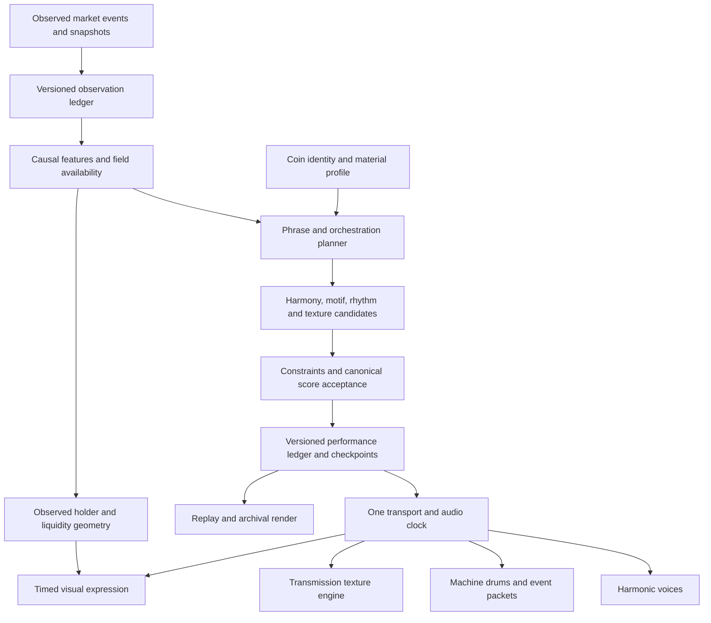

# UPIC transmission instrument design

23 October 2026 · Design proposal grounded in the current local working tree

## Product decision

UPIC should sound like its visual field: a transmission with a recognizable harmonic signal, granular noise, machine pulses, interference and breathing space. Each coin has a persistent identity. Real market observations determine when that identity becomes active and how it develops. Sound and image perform one composition.

The primary experience is listening to and watching a market become an artwork. Musical sophistication comes from memory, voice relationships, restraint and precise audiovisual timing. The engine must also remain usable on a phone and produce explainable historical reconstructions and reproducible recorded performances.

### The intended sound

- **Harmonic signal:** pulse and wave tones, a recurring interval/rhythm motif, connected voicings, occasional exposed bass. A melody can emerge and disappear into the material.
- **Transmission field:** tuned static, digital grain, hollow resonances, slowly shifting bands and restrained carrier modulation. This is the audible surface of the moving image.
- **Machine rhythm:** noise hats, compact pitch-drop drums, gates, ticks and short packet-like clusters. Rhythm supplies structure without occupying every available subdivision.
- **Memory:** occasional fragments of UPIC's own generated sound held, rearranged or gently degraded, followed by a recognizable return.
- **Depth:** contrast in register, envelope, stereo placement and short chip echoes. Sustained notes carry their own body. Long diffuse reverb is an explicit optional treatment.

These are original GB-inspired materials and musical behaviors, not a claim of exact Game Boy hardware emulation. Transmission noise is artistic material, not evidence of actual radio interference or a failed market feed.

## One source of musical decisions

The planner makes decisions. Sound generators perform them. The image reads the same accepted events and continuous expression curves. A rendered video frame never triggers an audio note; the audio clock remains authoritative even when rendering drops a frame.

## Current foundation and gaps

The following describes local source, including changes that have not been deployed or auditioned.

| Present in the local browser engine | Design work still required |
| --- | --- |
| Coin-seeded GB timbre and melodic contour | A versioned identity profile containing an explicit motif and separate random streams |
| Eight-bar introduction, answer, variation and return | Phrase planning across multiple sections with bounded transitions and memory |
| Shared rests, rolled chord attacks and varied envelopes | One-to-one voice leading, held common tones and a shared role allocator |
| Causal smoothing over recent bar contexts | Separate fast activity gating and slower expression controls with provenance |
| Seeded stochastic GB drum patterns and original drum synthesis | Auditioned balance, coordinated fills and one event-accent budget |
| Two replaceable Envion sample slots and market-controlled DSP | An original transmission texture engine with canonical modulation and seek state |
| Scheduled accepted-onset visual accents | Shared texture phase, grain gestures and phrase expression within the existing data geometry |
| Frozen candle-based reconstruction and visit-local observations | A durable accepted-performance ledger and explicit replay categories |

### Foundation defects to resolve before claiming exact reproduction

1. **Final melody acceptance can depend on listening history.** `trade-piano.js` invokes a mutable originality guard during playback. Seeking cancels pending notes but does not reconstruct a canonical predecessor history. Move this decision into score compilation.
2. **Harmony does not yet retain distinct voice identities.** The current compact-voicing search finds nearby chord tones but does not solve a one-to-one voice assignment using the actual preceding performance.
3. **The collectible renderer uses a different engine.** `packages/engine/src/index.ts` retains fixed tempo, an activity floor, GeneralUser samples and simplified visuals. The public player, lab and renderer must consume the same score core before exported works can be described as the same performance.
4. **Some source documentation predates the current code.** The earlier engine map describes GeneralUser, a long melodic reverb and absent onset coupling. The current melodic engine has GB sounds, short chip echoes and scheduled visual accents.
5. **Other layers still contain reverb.** Changing the melody did not remove Envion or data-sonification reverb. The new mix must explicitly define every layer's depth treatment.

## Coin identity and musical memory

Create a versioned `CoinCompositionProfile` from normalized network plus exact contract/native identity. Tickers are display labels. A profile contains tonic, a limited modal palette, interval/rhythm motif, register preferences, carrier/wave family, drum anchors, noise spectrum and visual-expression family.

Use separately named random streams for motif, harmony, percussion, texture and articulation. Seed each choice from its score address and purpose. Adding a new texture parameter must not change the melody by advancing a shared random generator.

Store the motif as intervals, rhythmic cells and accents. Harmony can transform it while preserving its contour and characteristic rhythm. A return should recall recognizable material, not simply re-run a generator against unrelated new inputs.

### Time hierarchy

| Scale | Responsibility | Initial design range |
| --- | --- | --- |
| Event | Articulation, small pitch/noise gestures, accepted audiovisual onset | Milliseconds to a beat |
| Bar | Chord voicing, groove occupancy, voice allocation | Four score beats |
| Phrase | Question, answer, omission, extension, cadence and shared rest | Start with the existing eight bars |
| Section | Expose, develop, contrast, return; choose which material leads | Two to four phrases, with minimum dwell time |
| Identity | Persistent motif, timbre and harmonic vocabulary | Versioned coin profile |

A new market observation changes eligible upcoming decisions. It does not restart the composition. Activity and transport gates can stop new excitation immediately; large harmonic or formal changes normally wait for a phrase boundary.

## Harmony and machine phrasing

Use the Wotja/Koan separation of scale, harmony, next-note and rhythmic constraints. Combine it with Chordjam-inspired voicing, delay and velocity ranges. The concrete UPIC mechanism is a phrase planner:

1. Choose a short harmonic path from the coin's permitted vocabulary and current formal role.
2. Enumerate voicings in the allowed registers.
3. Reject voice crossings and unsuitable melody/bass clashes.
4. Rank remaining candidates by total voice movement, common-tone retention, spacing, register balance and purposeful tension/resolution.
5. Select deterministically among the best few candidates, using a separate harmony stream.
6. Plan the complete melodic phrase against that path, using learned statistics as candidate priors.
7. Apply final source-sequence screening to the canonical phrase, including its predecessor context, before scheduling any sound.
8. Choose articulation, chord stagger and dynamics after the pitches are accepted.

Direction influences contour and harmonic tension with hysteresis. A tiny sign change should not instantly replace the harmonic vocabulary. Rising and falling prices should not be framed as morally positive or negative music.

Rhythm uses a small authored vocabulary of two- and three-unit cells, with probability-based omissions and answers. The GB drum pattern retains strong recurring anchors. Variations and fills respond to the current phrase role; rests are part of the score.

Introduce one independent accompaniment cycle first. An eight-bar theme can overlap a three-bar texture or accompaniment contour, all derived from the same absolute score clock. Current harmony and ensemble rests override local cycles. Slow phasing belongs primarily in texture; the main pulse should remain legible.

### Orchestration and change limits

Each phrase assigns roles: foreground, answer, sustain, texture, accent or rest. A burst of activity does not make every layer simultaneously louder, denser and brighter.

- If harmony changes substantially, retain the motif rhythm.
- If percussion becomes denser, reduce texture attacks or chord repetition.
- If noise takes the foreground, expose fewer harmonic voices.
- A large observed event gets one coordinated gesture, with a refractory interval, rather than independent accents from every subsystem.
- After an intense passage, reduce density before adding another novelty.

The initial rule is at most two substantial musical changes per phrase. This is a tunable design constraint, not a measure of intelligence or an invariant derived from research.

## Transmission texture machine

Replace Envion's production texture role with an original machine that retains its useful material, grain, tape and modulation controls. Keep compatibility with the existing two sample slots and sample-pack import/export. The machine generates its default materials locally; user-provided GB textures are optional.

This is a functional successor, not a promise of identical Envion DSP or identical output from old patches. Import material choices and map supported controls explicitly. Retain the original patch and attribution as an advanced reference during migration.

### Materials and operations

| Material | Original source | Treatment and job |
| --- | --- | --- |
| Static | Seeded long/short-register noise | Filtered grain, gated hiss, granular surface |
| Pulse | Band-limited pulse/wavetable cycles | Carrier, tuning gestures, compact harmonic bodies |
| Hollow | Sparse resonant partials and shaped noise | Related pitched space around the current chord |
| Metallic | Bounded FM/ring modulation and short envelopes | Occasional machine accents and instability |
| Sample | Existing main and tape material inputs | Scan, granular playback, pitch ratio, envelope and crossfade |
| Memory | Short render of UPIC's own accepted sound | Seeded fragment hold, reverse, reorder and bounded erosion |

Noise and pitched material share envelopes. Krell-inspired random modulation is smoothly bounded and changes at explicit score addresses. FM amount, filter movement, grain rate and envelope duration can vary; unrestricted feedback and unpredictable gain are excluded from the production path.

Tuned resonances follow the current harmony. Small detuning and microtonal sidebands belong to the texture role; the melodic voice retains its pitch constraints. A user sample marked as pitched needs a supplied or estimated root with a clear confirmation state. Untuned samples remain texture.

Memory operations retain an immutable source buffer and bounded edit history. Crossfade between edits and return to the original material at a planned formal point. Initial design: one short memory buffer, at most one mutation per phrase, limited wet mix and a fixed reset horizon. This takes the evolving-buffer principle from Corruption Loops while defining a different, reversible behavior for UPIC.

### Controls in Audio Lab

**Material · Grain size · Scan · Density · Roughness · Tune · Drift · Echo · Level**

Advanced controls can expose modulation ranges and the two sample inputs. Units remain visible. AUTO values follow the shared score state; manual overrides are recorded as performance settings. Controls that cannot be mapped from an old Envion preset are identified during import rather than silently reinterpreted.

## Matching the image and sound

Use one immutable expression frame plus discrete accepted events. Separate data geometry from artistic expression.

| Shared cause or state | Audible expression | Visual expression |
| --- | --- | --- |
| Coin identity | Motif, carrier family and noise spectrum | Existing artwork mask and pattern identity |
| Current observed activity | Gate, packet rate and rhythmic occupancy | Existing activity-driven motion envelope |
| Shared cyclic phase | Static scan and slow filter contour | Existing seamless procedural motion phase |
| Grain gesture | Short noise envelope | Small localized texture/luminance gesture |
| Accepted drum or note onset | Scheduled attack | Scheduled accent from the same event ID |
| Harmonic tension | Voicing spacing, extensions and bounded spectral roughness | Slow expressive phase/contrast change within approved visual parameters |
| Shared cadence/rest | Coordinated release and silence | Expression settles while data geometry persists |
| Available liquidity | Slow grain length and spectral-weight choice | Existing liquidity-to-mark-size representation |
| Holder observations | Optional slowly held material descriptor, never an excitation source | Observed-holder geometry and coverage |

Use the renderer's existing 24-unit cycle as a shared expressive phase, computed from transport time. Do not sample it from animation callbacks. Keep the visible population, liquidity size and existing direction glyphs attached to their documented sources. Live direction uses the market-cap readout; the historical candle mapping is separate and must remain explicitly identified. Artistic grain must not create apparent holders, alter reported values or imply new trades.

The meaningful relationship is: **the same gesture creates a noise event and a visible movement**. There is no need for one sound per pixel or holder, or for expensive audio analysis to rediscover scheduled notes.

## Market truth and behavior

Every mapped field carries its source, timestamp, availability and whether it is observed or derived. Unknown is not zero. Price direction and buy share are separate fields; the existing Envion summary that labels normalized direction as a buy percentage must not be carried into the new controls.

| State | Sound | Image and status |
| --- | --- | --- |
| Fresh, active observations | Coordinated harmony, packets and texture within phrase limits | Existing data geometry plus shared expressive motion |
| Fresh, genuinely quiet feed | Finish short envelopes; no new activity-driven attacks | Slow residual visual drift, with quiet feed distinguished from missing data |
| Burst of observed activity | One bounded accent; denser next eligible phrase | Coordinated gesture without fabricating population or magnifying values |
| Sparse price observations | Restrained phrases at supported observation boundaries | State clearly identifies periodic observations |
| Candle history | A composed interpretation of aggregates | Historical reconstruction label; no invented intra-candle trades or holders |
| Stale or missing source | Stop new excitation; release short tails | Settle the expressive field and show source status |
| Paused, seeking or hidden | Cancel future events; handle running sources explicitly | Freeze or reset according to transport state |

A visual idle motion is not permission to keep sounding static. Default production playback becomes silent when eligible activity is absent. An optional lab-only idle carrier must be explicitly identified as synthetic audition material.

Normalize activity and volatility against causal recent baselines so a smaller coin has an expressive range. Bound the normalized controls and retain their original values. Market cap can influence slow identity/register characteristics; it should not make a large coin permanently louder. Large derived value changes must not be presented as new observed trades.

## Score and evidence contracts

### Observation records

Store exact identity, event ID, source timestamp, receive timestamp, observed fields, quote conversion, source resolution, quality flags and availability. Timing corrections and reorgs append correction records. Never silently rewrite the evidence behind a frozen performance.

### Accepted performance records

Store score address, onset/duration, role, pitch or noise material, envelope, gain, modulation curves, component seeds, source references and engine versions. Include sample hashes, texture edit operations and cancellations. Newer market data can revise unsounded plans; already performed decisions become immutable history.

`compilePhrase()` must be pure with respect to a frozen context and explicit predecessor state. The originality guard, voice leading, role assignment and random choices run here, not inside a browser callback that depends on where a listener previously sought.

### Replay categories

- **Recorded performance:** accepted ledger, assets and required state are present. Replay follows the actual accepted composition.
- **Historical reconstruction:** available observations or candles are interpreted by a declared engine version. This can be deterministic without being a recording of the original live experience.

At the replay-to-live boundary, transfer beat/tempo integration, identity, motif/form state, accepted harmony, modulation state and the last consumed observation IDs. Resume the normal live source without replaying its previous events. If a gap prevents continuity, resolve the phrase and re-enter with the status visible.

### Frozen work manifest

Record the observation ledger hash, accepted-score hash, identity profile, random algorithm, composition/mapping versions, model and screening-index hashes, sample hashes, user overrides, initial DSP state and checkpoints, artwork/holder snapshot provenance, renderer version, sample rate, resolution, frame rate and encoding settings.

Identical score events are a cross-device requirement. Byte-identical audio and pixels require a pinned renderer environment. A single snapshot expanded into a piece must be described as a snapshot composition, not a recording of a live time window.

## Mobile and output design

Initial ceilings for the prototype, to be measured and tuned:

- Six simultaneous tonal voices across carrier, harmony, motif and bass; typical arrangements use fewer.
- Two percussion lanes with the existing bounded transient handling.
- One static bed and four concurrent texture grains; a lower rendering profile can use two grains while preserving accepted note timing.
- One shared short-echo bus with bounded feedback, high-pass filtering and explicit tail cancellation.
- Preallocated texture buffers and bounded queues; material preparation occurs off the real-time audio path.
- Reuse the existing audio-clock lookahead and the visual path's 30 FPS / 480,000-pixel budget initially.
- Smooth control changes, crossfade materials, remove DC, bound resonance and constrain source levels before the master stage.

Quality profiles describe rendering approximations, not different compositions. Preserve notes, identities and timing; reduce texture detail and visual raster work first. Freeze the selected quality profile for archival output. The renderer must not create a different melody because a phone has less CPU.

## Research translated into design

| Reference | Specific contribution | Use in UPIC |
| --- | --- | --- |
| [Rampoldi, Algorithmic Music Composing Techniques](https://www.youtube.com/watch?v=Tl85XW8wywU), [Edwards, Algorithmic Composition](https://cacm.acm.org/research/algorithmic-composition/) | Composition as designed processes and constraints | Authored system with bounded chance and explicit musical form |
| [IRCAM history](https://www.ircam.fr/en/magazine/a-brief-and-subjective-history-of-ai-technics-in-music-composition) | Multiple distinct approaches to composition and machine assistance | Keep composition, performance and sound generation as separate responsibilities |
| [Eno and Koan](https://intermorphic.com/archive/sseyo/koan/generativemusic1/), [Wotja music engine](https://wotja.com/guide/wme.html) | Parameterized musical systems and weighted rules | Coin profile, constrained choices and a composer separate from the renderer |
| [Tero Parviainen's presentation](https://teropa.info/loop/#/title) | Phasing, Riley's fragment system, rhythm grammar and live-data sonification | Independent cycles, motif vocabulary, rhythmic cells and causal market mapping |
| [Stochastic Drum Machine](https://codepen.io/teropa/pen/PKoYXM) | Persistent pattern with variable playback probabilities | Existing local GB drum implementation; develop orchestration around it |
| [Chordjam](https://audiomodern.com/shop/plugins/chordjam/) | Guided voicing, timing, velocity and progression variation | One-to-one voice-leading search and controlled articulation |
| [Generative.fm source](https://github.com/generativefm/generators) | Individually authored systems and asynchronous recurring material | Limited palettes, independent timescales and deliberate lifecycle management |
| [Todd Barton's Krell demonstration](https://www.youtube.com/watch?v=f4O3oFneUvE) | Interacting random envelopes, modulation and FM | Bounded texture behavior; its post-added detuned reverb is a separate optional effect |
| [Corruption Loops](https://github.com/alexbainter/corruption-loops) | Progressive changes to generated audio data | Optional bounded, reversible memory texture using UPIC's own rendered material |
| [OMax](https://www.stms-lab.fr/shop/product/omax/) | Navigable musical memory | Remember and transform UPIC-generated phrases; no dependency on the OMax runtime |
| [DeepBach](https://arxiv.org/pdf/1612.01010v1) | Contextual relationships between voices and steerable constraints | Joint phrase planning; no claim that its chorale model is loaded |
| [MusicVAE](https://magenta.tensorflow.org/music-vae), [NSynth](https://magenta.tensorflow.org/nsynth), [Orchidea](https://www.orch-idea.org/intro/) | Musical transition, timbre and orchestration as distinct design tasks | Candidate evaluation, material morphs and role assignment; optional offline research |
| Existing VGMusic statistical model | Aggregate rhythm, articulation and interval distributions | Candidate priors under UPIC's own harmony and identity rules; screening reduces reuse risk without guaranteeing no resemblance |
| [Kate Vass Galerie overview](https://www.katevassgalerie.com/blog/generative-music), [1951 computer-music recording](https://soundcloud.com/the-british-library/first-recording-of-computer-music-1951-copeland-long-restoration) | Historical and audiovisual context | Research-page background, rather than an extra runtime component |

These references inform an original application design. More models or simultaneous effects are not a success criterion. A neural generator, genetic search or a new training corpus is not required for the proposed runtime; offline phrase search can be evaluated later against the same constraints.

## Implementation order

| Stage | Deliverable | Gate before proceeding |
| --- | --- | --- |
| 1. Canonical core | Shared identity, observation quality, score acceptance, transport and deterministic checkpoints | Continuous play and arbitrary seeks produce the same accepted event sequence |
| 2. Transmission prototype | Original carrier/static/packet machine with compatible sample inputs in Audio Lab | Quiet, active and stale behavior; predictable material controls; acceptable phone cost |
| 3. Composition and orchestration | Explicit motif memory, voice leading, phrase roles, bounded independent cycles | Musical identity remains recognizable through contrasting market conditions |
| 4. Shared expression | One phase and event bus for sound and the active visual renderer | Accepted onsets align; holder/liquidity geometry remains truthful |
| 5. Replay and render parity | Same core in main player, lab, historical reconstruction and collection renderer | Matching score hashes and truthful evidence manifests |
| 6. Release and testnet | Auditioned, measured performance and reproducible frozen works | Physical-device review and artifact verification before public claims |

Start with one complete path: one coin identity, one coherent phrase, carrier/static/packets, one truthful market input and one synchronized visual. Expand the vocabulary after that path is musically convincing.

### Release criteria to execute during implementation

The following are future acceptance checks, not results from this design task:

- Frozen input and versions produce matching ordered accepted events after reload, backward seek and forward seek.
- Quiet, missing, stale, reorg, delayed and reconnect cases create no fabricated or duplicated market accents.
- Replay distinguishes recorded performance from candle reconstruction and reaches live playback without duplicated attacks.
- Pause, coin change, seek and background transitions cancel old queued sound and visual events.
- Main player and collectible renderer agree on the canonical score and all asset identities.
- Supported physical iPhone Safari completes a 15-minute busy scenario without audible underruns, sustained memory growth or severe thermal slowdown; assess 30 FPS and audiovisual alignment within one visual frame as initial targets.
- Listen on phone speakers and headphones for motif recognition, balanced noise/harmony, fatigue, clicks, clipping, excessive harshness and purposeful silence.
- Lower rendering quality preserves the composition; archival output records its exact profile and environment.

## Source ownership and integration seams

- `apps/web/public/market-state.js`, `music-context.js`, `market-landmarks.js`: causal feature interpretation and harmonic context.
- `phrase-development.js`, `phrase-arrangement.js`, `composition-context.js`, `market-composition.js`: current phrase planning; migrate pure decisions into a shared versioned core.
- `learned-market-phrase.js`: statistics and source guard; move final acceptance into canonical compilation.
- `gameboy-drum-pattern.js`, `gameboy-drums.js`, `gameboy-instruments.js`: original chip rhythm and materials.
- `trade-piano.js`: scheduler and instrument rendering; consume accepted events rather than choose pitches during playback.
- `envion-samples.js`, `envion-sample-editor.js`: retain material input compatibility for the proposed texture engine.
- `envion-market.js`, `envion-performance.js`, `data-sonification.js`: consolidate overlapping gates, expressive mappings and event accents.
- `upic-earthbound-visual.js`, `upic-oct07-renderer.js`, `oct07-live/earthbound-loop.js`: active visual integration, truthful geometry and phase.
- `market-replay.js`, `replay-score.js`, `replay-visual-history.js`: reconstruction categories and evidence handling.
- `packages/engine/src/index.ts`, `apps/renderer/src`, `apps/api/src/services.ts`: eliminate divergent collectible score decisions and capture sufficient source history.

The separate collection platform, wallet authorization and deployed contract eligibility retain their own responsibilities. A richer audio design does not by itself make tokenization available.
