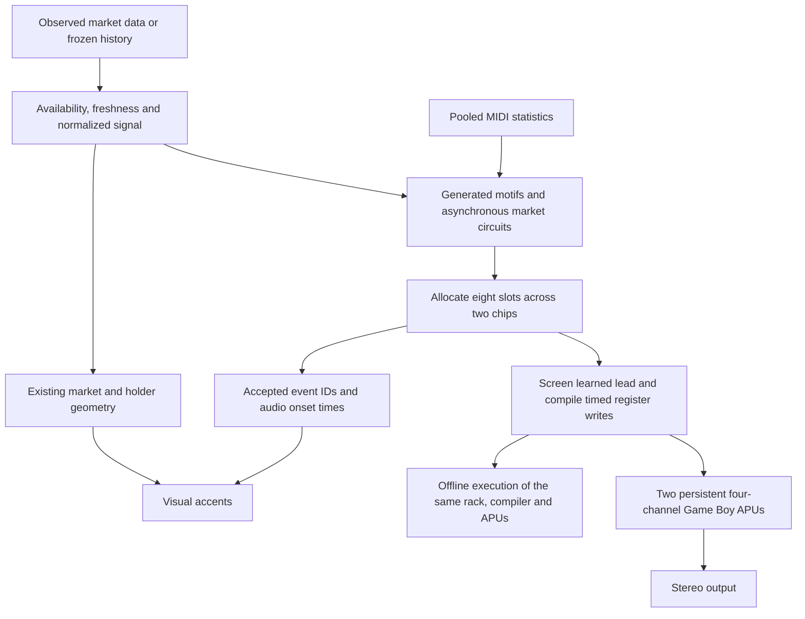

# UPIC transmission instrument

Current implementation and continuation plan · 24 October 2026.

## Product direction

**Noise, harmony, machine signals and transmission behavior, generated by two four-channel Game Boy APUs and driven by observed market changes.**

Each coin should have a recognizable circuit: different phase relationships, register behavior, wave character and packet opportunities. Its changing observations excite that circuit. The intended result is an evolving electronic field, with pitched structure emerging through noise and interlocking pulses.

Every audible component goes through the MAME-derived Game Boy core, including offline artwork audio. The raw single-chip version 468 was deployed at commit `a84fac4`; version 469 added a second instance of that unchanged core and learned musical phrasing. Version 470 shared the audio/visual observation policy and introduced sparse harmony. Version 471 corrects arp/chord presence, pulse envelopes and replay continuity while keeping the circuit stable under market updates. Each chip retains four channels. The host has explicit Pan Docs corrections and a browser/offline output adapter; it is not an exact MAME executable or a verified physical-console replica. This replaces the earlier sampled-instrument/Envion design.

Version 471 passed 340 automated tests, production build and workspace type checks, with two environment-dependent tests skipped. A new 32-second ETH reconstruction and actual-APU support checks are recorded below. Version 469's preview and version 470's 304-test result remain historical evidence for those revisions. No subjective audition, browser playback, phone measurement or hardware conformance is claimed.

## One causal signal path

The composer chooses events. The register compiler chooses hardware instructions. The sound core executes counters and registers; it does not improvise. The visual renderer receives accepted onsets and market-derived fields rather than manufacturing another sequence.

## Eight slots across two chips

| Slot on each chip | Sound source | Foreground chip / Harmony chip |
| --- | --- | --- |
| CH1 | Pulse, stepped envelope and sweep | Lead and kick/tom / Lower chord tone |
| CH2 | Pulse and stepped envelope | Arpeggio and scored echo / Upper chord tone |
| CH3 | 32-sample, 4-bit wave RAM | Bass / Waveform-resonance drone |
| CH4 | Clocked long/short-register noise | Percussion / Texture grains |

The layer controls are **Signal**, **Texture** and **Packets**. Their compatibility keys remain `piano`, `envion` and `data`; those keys do not imply that the previous engines still run.

Tonal percussion shares the foreground lead lane; arpeggios and their echoes share its second pulse lane. At admitted chord entrances, two pulse tones and a simultaneous wave root occupy the second chip. A separate wave drone can enter selected non-chord bars. Texture occupies that chip's noise lane. Later events replace or truncate their `(chip, channel)` occupant. The rack gives each chip fixed 0.55 output gain before master volume.

The original 32-step wave tables are packed into CH3 RAM. They are not decoded as sampled instruments. Bass is now CH3 rather than the earlier Kraken sample bank.

## Market data creates the differences

`marketPerformance()` interprets the same observation for the chip score and visual motion: availability, source freshness, activity recency, activity, volume, motion, intensity, price delta, balance, trade rate, market cap and liquidity. `marketChipSignal()` adds observation/full fingerprints for inspection and caching. Fingerprints do not seed the scheduled circuit's random gates. Separate availability flags remain attached to volume, balance and trade rate; missing market cap/liquidity remain null. Missing values must not be relabeled as observed data.

| Input | Current artistic mapping |
| --- | --- |
| Coin seed | Stable motif, harmonic field, circuit periods, phases, duty and wave identity |
| Observation fingerprint | Input identity and cache invalidation; does not reseed motif candidates or packet gate thresholds |
| Activity / trade rate | Number and density of eligible packet opportunities |
| Observed volume | Packet multiplicity and body; bounded bursts rather than a generic fill |
| Price-change direction / magnitude | Bounded tonal bends and packet expression within the stable harmonic field |
| Motion | Noise clock shift/width and irregular timing depth |
| Buy share, when available | Duty and left/right routing decisions |
| Activity recency | Admission probability and role presence; expires without a qualifying observation |
| Source freshness | Separate excitation eligibility and event-gain attenuation |
| Market cap / liquidity | Harmonic waveform color / eligible grain size; cannot create activity |
| No new observation | Shared activity release reaches zero; a cached repaint does not renew activity |

These are composition mappings, not a claim that a tone directly measures a financial quantity. The interface must distinguish observed values from normalized artistic controls. A neutral fallback balance must not be labeled an observed 50% buy share.

Live `tradingActivity` is authoritative, while `excitation = fresh × tradingActivity`. Its shared decay has a two-second grace, an eight-second exponential time constant and a hard stop at 30 seconds. The app advances its activity timestamp for actual price changes, decoded trades and pool events. Identical price polls and unchanged snapshots do not advance it. The audio and visual hosts also decay a cached input if their frame supply stops. High rolling volume or descriptive intensity cannot keep stale observations audible indefinitely.

Rate and normalized activity share one pace axis; motion and absolute price change share one movement axis. They are combined with maxima instead of repeatedly adding measures of the same event. Composition energy combines pace, volume and movement. Pressure can deepen a selected tonal bend, and intensity can shape expression within already eligible activity. Liquidity and market cap affect only a permitted event's color/size.

### Generated motifs and asynchronous circuits

`market-chip-score.js` now combines newly generated two-bar motifs with an eight-bar introduce, answer, vary and return form. Its compact model contains 301 pooled lead, bass and drum distributions from 31,136 usable unique arrangements. Lead intervals/rhythm, bass timing/gates and drum accents/gates draw on those statistics. Harmony, form and channel roles remain authored rules; no source song is selected or replayed.

The foreground chip carries separate lead, arpeggio and bass parts. Harmonic degree changes once per two bars as an internal field. Eligible activity admits a chord at one seeded position every four bars; composition energy of at least 0.55 can add the opposite position, two bars away. Whole-chord admission and level release with activity recency, while quiet valid candles no longer face an extra volume-probability veto. Other bars remain chord-free. The chord's two pulses are staggered by 0.025 beat, with a shared wave root, and last 0.45–1.70 beats before phrase/channel limits. A separate probabilistic drone can enter selected bars without a chord.

An arp is a two- to four-note answer run in the actual response window, not a set of independent note coin flips. The score fits four stable candidate times between the window's full-focus start and its next rest, then chooses a two-note prefix, three notes at energy 0.22 or higher, or four at 0.55 or higher. The pair's score address controls placement; observed recency gates/fades the whole gesture. A note may finish across the pair's middle bar line, still bounded by common rests and channel ownership. Positive candle volume establishes eligibility without replacing its real normalized pace or volume with a maximum value.

`chip-ensemble-arrangement.js` assigns stage-specific lead/arpeggio response windows and gives the later part of a bar more drone/texture presence. These are opportunities, not mandatory entries. Role gains are applied at event onsets, not as continuous gain automation over held notes. Falling activity recency reduces admissions and scales role presence by its square root; source freshness is applied once to score-event gain. Shared breaths occupy beats 14.5–16 and 30–32 in each 32-beat cycle, and the score caps all roles at those boundaries.

The drum planner keeps independent prime periods and phase offsets. There is no fixed kick/backbeat template or automatic phrase-ending fill. Tonal percussion leaves gaps for the lead. Chip texture grains use stable candidate times with activity-dependent admission/duration, volume-dependent overlap proposals and motion-dependent expression. Actual overlap is limited by replacement on one noise lane. These Envion-inspired relationships are evaluated on the common score clock, not an independent sample-grain timer.

The coin seed defines the underlying circuit. `drumVariation` changes that circuit; `drumPerformance` changes its bounded deviations while retaining its base periods. Seed, variation settings and score position address stable candidates and probability thresholds. Market values alter admission, articulation and register expression without changing the motif generator's random walk or replacing the whole drum pattern. Observation fingerprints identify the current evidence rather than rerandomizing it. There is no wall-clock randomness.

The 16-cell Audio Lab display is a compact binning of the first eight beats of asynchronous opportunities. It is not a quantization grid or a claim that every visible cell will sound after channel arbitration.

### Bounded expression

Packets carry explicit register expression: duty, envelope, noise shift/divider/width, pan and tonal slide. Event gain remains meaningful after conversion to the chip's discrete volume levels.

Version 471 requests chord pulse initial levels of `11 + round(3 × volume)` with envelope pace 0. After gain scaling and four-bit quantization, that level holds for the scored duration or until replacement. Arps request `11 + round(2 × intensity)` and pace 3, giving their downward envelope more time. These are targeted score settings, not a global nonzero-volume floor or a change to the sound core. They prevent the former short envelope settings from turning long scored harmony into brief clicks.

The packet planner retains at most 12 candidates per scheduling bar, resolves near-coincident hardware-lane collisions and truncates a lane's tail when the next event replaces it. The combined score applies phrase rests and final allocation across eight slots. Direct observation packets are spaced at least 0.4 seconds apart and also respect those rests.

Activity must not turn every role into a dense foreground. The second chip supplies room for simultaneous harmony, while role windows and rests determine which parts come forward. Extra roles still compete within eight explicitly allocated slots.

## Transmission materials inside the APUs

- **Signal:** pulse duty, integer period changes, short register bends and stepped envelopes.
- **Harmony:** occasional overlapping pulse tones and a wave root on the harmony chip, alongside foreground bass.
- **Drone:** an authored 32-sample, four-bit wave with a market-controlled harmonic peak; waveform coloration rather than a resonant-filter simulation.
- **Texture:** the harmony chip's noise clock, divider and register width form short Envion-inspired chip grains.
- **Echo:** quieter arpeggio repeats occupy the foreground chip's second pulse lane and use real chip envelopes.
- **Machine packets:** bounded groups of short register events, with volume-dependent multiplicity and observed direction.
- **Wave movement:** authored 32-step shapes loaded into CH3 while disabled, followed by its normal trigger.

All these materials are chip events. There is no external noise oscillator, granular PCM playback, direct FM synthesizer or conventional reverb/delay bus. Envion informs duration/overlap relationships, envelope-shaped role windows and boundary-held decisions; its sample buffers and Pd DSP are not running.

The waveform-upload workflow is consistent with the reviewed [GB303 playback source](https://github.com/furrtek/GB303/blob/master/src/playback.asm): disable CH3, load its 16 packed wave-RAM bytes, then re-enable/trigger it. No GB303 code or wave assets were imported.

## Image and sound share accepted events

The active visual renderer retains its existing market, liquidity and holder geometry. Audio events do not invent holders or change the meaning of observed balances.

Accepted note, packet and texture onsets carry their actual audio-clock time and cancellation state into the visual event queue. The current implementation applies small score-driven luminance accents. This is a specific implemented relationship; a full visual simulation of all chip registers is not claimed.

| Shared information | Sound | Image |
| --- | --- | --- |
| Coin identity | Circuit and register character | Existing coin artwork/pattern identity |
| Shared observation and recency | Excitation, admission probability and role presence | Existing motion envelope |
| Accepted onset | Chip channel trigger | Scheduled accent |
| Cancellation / pause / stale state | Cancel future authorization | Clear invalid queued accents |
| Liquidity / market cap | Grain size / waveform color, never a fabricated trade trigger | Existing observed-data geometry |
| Holder evidence | No invented sound events | Existing observed holder geometry |

Do not describe the visual as driven by audio amplitude when it is driven by accepted score events. Do not infer a continuous sound bed from a visual's slow idle motion.

## Quiet, stale and historical states

| State | Sound policy |
| --- | --- |
| Fresh observations with eligible activity | Authorize bounded asynchronous signal, texture and packets |
| Observed zero activity | Stop new excitation |
| Missing or stale observations | Stop new excitation and expose the source state |
| Unchanged but still eligible observations | Retain the circuit while activity releases; do not renew it merely because a visual frame was rendered |
| Paused, seeking, coin change or closed | Cancel old queued events and channel ownership through the transport |
| Candle history with known positive volume | Interpret aggregate activity; do not invent intra-candle trades |
| Candle history with explicit zero volume | Remain silent even if open and close differ |
| Candle history with missing volume | Permit actual open-to-close movement, while keeping volume unavailable |
| Frozen artwork input | Reconstruct from its actual frames with the declared engine settings |

The live scheduler expires excitation unless a new price change or increasing activity timestamp renews it. It also closes its output gate when the normalized signal is ineligible. Old musical metrics must not authorize sound indefinitely after a source stops updating. Legacy interfaces must pass the normalized signal explicitly; the packet gate has no synthetic activity default. The visual's slow ambient movement does not authorize audio.

Replay audio and visuals share `controlsForBar()`. A frozen recorded observation can be used only at or before the current cursor and when it matches the closed bar's time/price. Otherwise `scoreCandle()` derives motion from absolute open-to-close percent change divided by eight, and both activity and volume from logarithmically normalized volume per second. A candle supplies neither individual trades, buy/sell balance nor historical liquidity. Its explicit zero volume takes precedence over price movement; missing volume remains unknown. Controls resolve lazily and are cached within the frozen replay, preserving the closed-bar boundary without eagerly rescoring every prefix.

Held replay notes can cross consecutive eligible candle boundaries until their scored release. `timeline.activeUntil()` limits them at the first known inactive interval or gap, even when that interval is a 10 ms candle shorter than an audio scheduling tick. Only future availability is consulted for this release bound; future pitches, prices and dynamics do not compose the current note. Observed inactivity clears held channel ownership, preventing an old note from returning when output reopens. Seeking also clears ownership and queued notes.

## Runtime and offline execution

The current files divide responsibilities as follows:

| Source | Responsibility |
| --- | --- |
| `market-performance.js` | Shared observation availability, activity decay, source freshness and candle policy |
| `market-chip-score.js` | Input fingerprints, learned motifs, sparse harmony, circuit composition and final channel allocation |
| `market-replay.js` | Shared recorded-observation/closed-candle controls, cached within frozen replay |
| `midi-phrase-model.js` | Aggregate lead/bass/drum statistics, with source coverage and checksum |
| `phrase-development.js` | Generated two-bar memory and eight-bar development |
| `chip-ensemble-arrangement.js` | Stage-dependent role windows, shared cadence breaths and chip-grain proposals |
| `gb-chip-rack.js` | Two APUs, eight-slot routing and identical fixed live/offline mixing |
| `gameboy-drum-pattern.js` | Deterministic asynchronous packet opportunities and expression |
| `gb-apu-instrument.js` | Shared final learned-lead guard, event-to-register compiler and offline execution |
| `gb-apu-worklet.js` | Browser command queue, generations, channel ownership and cancellation |
| `mame-gb-apu.js` | MAME-derived counters, registers, wave/noise state and documented hardware/output corrections |
| `gb-apu-silence.js` | Shared DAC-enabled rests for browser and offline execution |
| `trade-piano.js` | Live/replay transport, finite observation authorization and accepted-onset publication |
| `chip-timeline.js` | Replay beat mapping and held-note release bounded by the first inactive interval |
| `upic-earthbound-visual.js` | Consume the shared observation/decay policy and accepted onsets while preserving data geometry |
| `engine-view.js` | Inspect both four-channel snapshots and current observations |
| `packages/engine/src/index.ts` | Derive a score from frozen frames and render through the shared chip path |

The host adapts the chip state machine to browser/offline output samples, retaining fractional chip time and integrating transitions. It does not copy MAME's complete emulator scheduler or sound-stream pipeline. Queues, accepted events and offline renders have explicit size limits. The earlier original `gb-apu-core.js` is retained only as an inactive reference.

Normal rests keep DACs connected: pulse/noise channels load zero volume and CH3 uses its digital output mute. CH3 is separately disabled when replacing wave RAM. This removes avoidable DAC-off transitions at every note ending without promising that all hardware register changes are click-free.

Sharing the composer and compiler removes the former sample-engine fallback in the artwork path. It does not make unrelated live and frozen inputs equivalent. A single market snapshot interpreted over a time window is still a snapshot composition.

The browser verifies the source interval index asynchronously. Original chip support and packets can sound while learned lead candidates wait; unverifiable lead candidates are withheld. The shared final driver checks learned pitches after harmonic fitting and channel allocation, retaining preceding accepted notes across bars. Offline rendering awaits index preparation and uses the same guard. Matching nine-note source runs are revoiced or withheld; this does not establish perceptual originality.

## Replay and evidence contracts

A deterministic reconstruction is not automatically a recording of an earlier performance.

- **Historical reconstruction:** declared observations, settings and versions are interpreted again.
- **Recorded performance:** the actual accepted register/event timeline and necessary chip state are retained.

The present offline renderer, identified as `upic-nft-gb-v5` for version 471, prepares the verified source index, resets both chips and executes from the beginning, including before a requested output window. This retains envelopes, noise state, wave state and earlier channel replacements. Version 470 used `upic-nft-gb-v4`; version 469 used `upic-nft-gb-v3`.

Further work on frozen-performance provenance should record exact coin identity, observation timestamps and source resolution, signal/mapping version, score/register timeline, model, sample rate, settings and render environment. Record corrections and cancellations explicitly. A durable accepted-performance ledger and verified arbitrary-seek equivalence remain acceptance work; this document does not claim they are complete.

## Research translated into this implementation

| Reference | Contribution to UPIC |
| --- | --- |
| [MAME Game Boy sound device](https://github.com/mamedev/mame/blob/master/src/devices/sound/gb.cpp) | Source basis for the JavaScript sound host, under BSD-3-Clause; credited to Wilbert Pol and Anthony Kruize |
| [Pan Docs](https://gbdev.io/pandocs/Audio.html) | Primary specification for the four-channel sound machine |
| [GB303](https://github.com/furrtek/GB303) | A practical wave-RAM instrument workflow |
| Supplied Envion 5.2 by Emiliano Pennisi | Inspected duration/overlap scheduling, grain envelope windows and held performance decisions; adapted as score-driven chip events without its sample DSP |
| [Ken Shirriff's analysis](https://www.righto.com/2020/05/reverse-engineering-audio-chip-in.html) | Distinguishes the external speaker/headphone amplifier from APU generation |
| [Eno / Koan](https://intermorphic.com/archive/sseyo/koan/generativemusic1/) and [Wotja](https://wotja.com/guide/wme.html) | A composition can be a set of constraints and interacting processes |
| [Tero Parviainen](https://teropa.info/loop/#/title) and [Stochastic Drum Machine](https://codepen.io/teropa/pen/PKoYXM) | Independent cycles, causal data mapping and probability-based variation |
| [Generative.fm](https://github.com/generativefm/generators) | Separately authored recurring processes with clear lifecycles |
| [Krell demonstration](https://www.youtube.com/watch?v=f4O3oFneUvE) | Interacting bounded changes, adapted here to legal chip-register sequences |
| [Corruption Loops](https://github.com/alexbainter/corruption-loops) | Evolving material as a conceptual reference; no PCM corruption machine is active |
| [Rampoldi](https://www.youtube.com/watch?v=Tl85XW8wywU), [Edwards](https://cacm.acm.org/research/algorithmic-composition/) and [IRCAM](https://www.ircam.fr/en/magazine/a-brief-and-subjective-history-of-ai-technics-in-music-composition) | Historical and conceptual grounding for rule-based composition |
| [Chordjam](https://audiomodern.com/shop/plugins/chordjam/), [OMax](https://www.stms-lab.fr/shop/product/omax/), [DeepBach](https://arxiv.org/pdf/1612.01010v1), [MusicVAE](https://magenta.tensorflow.org/music-vae), [NSynth](https://magenta.tensorflow.org/nsynth) and [Orchidea](https://www.orch-idea.org/intro/) | Research context for relationships, memory, timbre and orchestration; none is an active runtime model |

The active transmission score combines original market-to-register composition with pooled MIDI statistics and the shared source-phrase guard. The model uses every readable unique arrangement in the downloaded corpus; 138 malformed files and the unavailable new-submissions page remain excluded. Musical references contribute concepts and aggregate behavior rather than imported compositions or recordings. MAME is an explicit code dependency at the sound-device layer, with its attribution retained; that provenance must not be described as conceptual research only.

Ken Shirriff's article concerns the AMP-MGB amplifier receiving generated stereo audio, not the APU's four generators. Transistor-level amplifier reconstruction is outside this sound engine.

## Accuracy and release status

See [Game Boy sound](GAME-BOY-SOUND.md) for the precise implemented hardware behavior and limits.

The core is sound-only. It does not implement a CPU, DIV-write coupling, every model revision's envelope quirks or exact CPU/wave-RAM arbitration. DMG RAM-access/corruption behavior is not hardware-verified. Output event averaging is not a complete anti-alias filter, and the physical headphone/speaker amplifier is not modeled. Upstream MAME marks Game Boy sound imperfect; deriving from it does not resolve those limits automatically.

The adaptation documents corrections for duty retriggers, CH3 buffering, extreme noise-clock settings, stereo register semantics and DAC/DC-removal behavior against current Pan Docs. CH3 retains MAME's six-cycle startup delay; envelope writes retain MAME's interpretation rather than a complete revision-specific zombie model. `cgb` means CGB04; `mgb` uses DMG digital logic with its selected output-filter constant. The output adapter also differs from MAME's complete runtime. Describe it as MAME-derived with hardware corrections, not bit-identical MAME audio or proven hardware accuracy. The distributed [MAME license](../../apps/web/public/vendor/licenses/mame-gb/LICENSE.txt) and [provenance](../../apps/web/public/vendor/licenses/mame-gb/PROVENANCE.md) record the source dependency.

**Historical version 469 evidence:** the 32-second ETH preview contains 231 scored events across all eight channels, finite output and a peak of approximately 0.198 with fixed rack headroom and master gain. Lead, arpeggio, echo, chord, bass, drone, percussion and texture roles are represented. The final lead guard reported two revoicings and zero blocked candidates; this is not a count of unchanged audible events. Build checks succeeded for that revision.

**Historical version 470 validation:** 304 automated tests, production build and workspace type checks passed, with two environment-dependent tests skipped. These covered shared input interpretation, replay cache isolation, sparse harmony and transport release.

**Version 471 evidence:** 340 automated tests passed, with two environment-dependent tests skipped; production build and workspace type checks passed. Thirty-two support-presence tests exercise the actual APU: the sampled pulse levels are at least 2/15, chords remain held at 250 ms and arps remain active at 60 ms. Four replay regressions cover continuity and inactive release boundaries. A new 32-second ETH reconstruction from the same historical trade window contains 228 scored events across all eight channels, peak approximately 0.198 and RMS approximately 0.02185, with two lead revoicings and zero blocked candidates. This remains a historical reconstruction, not a captured live performance or a subjective audition. No browser playback, phone profiling, hardware comparison or conformance suite is claimed.

### Next acceptance work

1. Confirm source availability, stale/zero activity, pause, seek and reconnect behavior.
2. Compare live and offline register instructions for the same frozen inputs and settings.
3. Confirm channel replacement never lets an old note-off stop a newer owner.
4. Listen to several contrasting coins and changing observations for recognizable identity, purposeful silence, harshness and clipping.
5. Measure the actual phone's worklet timing, visual frame rate and memory behavior.
6. Verify frozen manifests and historical labels before describing output as a captured live performance.

These are pending acceptance tasks, not completed results. Publication, wallet authorization and testnet tokenization keep their separate release requirements.
