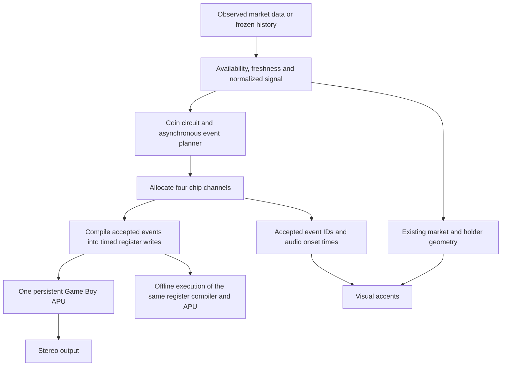

# UPIC transmission instrument

Current implementation and continuation plan · 23 October 2026.

## Product direction

**Noise, harmony, machine signals and transmission behavior, generated by one four-channel Game Boy APU and driven by observed market changes.**

Each coin should have a recognizable circuit: different phase relationships, register behavior, wave character and packet opportunities. Its changing observations excite that circuit. The intended result is an evolving electronic field, with pitched structure emerging through noise and interlocking pulses.

The current local implementation replaces the earlier sampled-instrument/Envion design. Every audible component goes through the MAME-derived Game Boy APU, including offline artwork audio. The host has explicit Pan Docs corrections and a browser/offline output adapter; it is not an exact MAME executable or a verified physical-console replica. This document supersedes the earlier proposal for expanded polyphony, a separate granular texture machine, sample inputs, direct FM and an effect bus.

This update includes source inspection, successful build/type checks and a 24-second public ETH trade-driven offline render. It does not claim a listening result, phone measurement or hardware-conformance result.

## One causal signal path

The composer chooses events. The register compiler chooses hardware instructions. The sound core executes counters and registers; it does not improvise. The visual renderer receives accepted onsets and market-derived fields rather than manufacturing another sequence.

## Four shared hardware slots

| Slot | Sound source | Current allocation |
| --- | --- | --- |
| CH1 | Pulse, stepped envelope and sweep | Foreground signal, tonal packets, kick/tom |
| CH2 | Pulse and stepped envelope | Harmony and interlocking answers |
| CH3 | 32-sample, 4-bit wave RAM | Bass and authored wave character |
| CH4 | Clocked long/short-register noise | Static texture, hat/snare and noise packets |

The layer controls are **Signal**, **Texture** and **Packets**. Their compatibility keys remain `piano`, `envion` and `data`; those keys do not imply that the previous engines still run.

Texture and percussion compete for CH4. Tonal percussion competes with the signal on CH1. A chord or sustained texture cannot allocate invisible extra voices. Later accepted events replace or truncate their channel's previous occupant.

The original 32-step wave tables are packed into CH3 RAM. They are not decoded as sampled instruments. Bass is now CH3 rather than the earlier Kraken sample bank.

## Market data creates the differences

`marketChipSignal()` creates an explicit signal containing observation availability, freshness, source, activity, volume, motion, intensity, price delta, balance and trade rate. It retains separate availability flags for volume, balance and trade rate. An observation fingerprint addresses circuit gates; a full fingerprint includes freshness, intensity and source for caching. Missing values must not be relabeled as observed data.

| Input | Current artistic mapping |
| --- | --- |
| Coin seed | Different circuit periods, phases, pitch register, duty choices and wave identity |
| Observation fingerprint | Different occupancy decisions for the currently observed state |
| Activity / trade rate | Number and density of eligible packet opportunities |
| Observed volume | Packet multiplicity and body; bounded bursts rather than a generic fill |
| Price-change direction / magnitude | Signed tonal bends, register changes and harmonic tension |
| Motion | Noise clock shift/width and irregular timing depth |
| Buy share, when available | Duty and left/right routing decisions |
| Freshness | Excitation eligibility and attenuation |
| No new observation | Freshness decays and excitation expires; a cached repaint does not renew activity |

These are composition mappings, not a claim that a tone directly measures a financial quantity. The interface must distinguish observed values from normalized artistic controls. A neutral fallback balance must not be labeled an observed 50% buy share.

### Asynchronous circuits

`market-chip-score.js` gives signal, harmony, bass and texture independent periods. `gameboy-drum-pattern.js` gives the four packet types distinct prime periods and phase offsets, evaluated in absolute beat coordinates.

There is no forced kick on beat zero, fixed snare backbeat, automatic end-of-phrase fill or repeating two-bar human groove. Bar boundaries are scheduling windows. They do not reset the independent circuits.

The coin seed defines the underlying circuit. `drumVariation` changes that circuit; `drumPerformance` changes its bounded deviations while retaining its base periods. The observation fingerprint changes gates. Choices are addressed by seed, observation and score position; they do not use wall-clock randomness.

The 16-cell Audio Lab display is a compact binning of the first eight beats of asynchronous opportunities. It is not a quantization grid or a claim that every visible cell will sound after channel arbitration.

### Bounded expression

Packets carry explicit register expression: duty, envelope, noise shift/divider/width, pan and tonal slide. Event gain remains meaningful after conversion to the chip's discrete volume levels.

The packet planner accepts at most 24 events per scheduling bar, resolves near-coincident hardware-lane collisions and truncates a lane's tail when the next event replaces it. The combined score performs final allocation across all four chip channels.

Activity must not turn every role into a dense foreground. Continued design work should tune the priority and scarcity of each role while respecting the same four physical slots. Greater complexity should come from changing relationships, not additional synthesizers.

## Transmission materials inside the APU

- **Signal:** pulse duty, integer period changes, short register bends and stepped envelopes.
- **Harmony:** interlocking CH1/CH2 material with CH3 bass; simultaneous harmony is limited by available channels.
- **Texture:** CH4 clock shift, divider and register width create static, periodic buzz and separated digital transitions.
- **Machine packets:** bounded groups of short register events, with volume-dependent multiplicity and observed direction.
- **Wave movement:** authored 32-step shapes loaded into CH3 while disabled, followed by its normal trigger.

The existing code does not synthesize direct FM, run an external noise oscillator, play granular PCM, or add reverb/delay to these materials. Future memory or echo-like behavior must be represented as new register events that use the same four channels. Imported sample playback is outside the current production path.

The waveform-upload workflow is consistent with the reviewed [GB303 playback source](https://github.com/furrtek/GB303/blob/master/src/playback.asm): disable CH3, load its 16 packed wave-RAM bytes, then re-enable/trigger it. No GB303 code or wave assets were imported.

## Image and sound share accepted events

The active visual renderer retains its existing market, liquidity and holder geometry. Audio events do not invent holders or change the meaning of observed balances.

Accepted note, packet and texture onsets carry their actual audio-clock time and cancellation state into the visual event queue. The current implementation applies small score-driven luminance accents. This is a specific implemented relationship; a full visual simulation of all chip registers is not claimed.

| Shared information | Sound | Image |
| --- | --- | --- |
| Coin identity | Circuit and register character | Existing coin artwork/pattern identity |
| Observed activity | Excitation and packet occupancy | Existing motion envelope |
| Accepted onset | Chip channel trigger | Scheduled accent |
| Cancellation / pause / stale state | Cancel future authorization | Clear invalid queued accents |
| Liquidity and holder evidence | Context, never a fabricated trade trigger | Existing observed-data geometry |

Do not describe the visual as driven by audio amplitude when it is driven by accepted score events. Do not infer a continuous sound bed from a visual's slow idle motion.

## Quiet, stale and historical states

| State | Sound policy |
| --- | --- |
| Fresh observations with eligible activity | Authorize bounded asynchronous signal, texture and packets |
| Observed zero activity | Stop new excitation |
| Missing or stale observations | Stop new excitation and expose the source state |
| Unchanged but still eligible observations | Retain the circuit within its finite excitation window; do not renew the window merely because a visual frame was rendered |
| Paused, seeking, coin change or closed | Cancel old queued events and channel ownership through the transport |
| Candle history | Interpret known aggregates; do not invent intra-candle trades |
| Frozen artwork input | Reconstruct from its actual frames with the declared engine settings |

The live scheduler expires excitation unless qualifying observations renew it. Old musical metrics must not authorize sound indefinitely after a source stops updating. Legacy interfaces must pass the normalized signal explicitly; the packet gate has no synthetic activity default.

## Runtime and offline execution

The current files divide responsibilities as follows:

| Source | Responsibility |
| --- | --- |
| `market-chip-score.js` | Observed-data normalization, circuit composition and final channel allocation |
| `gameboy-drum-pattern.js` | Deterministic asynchronous packet opportunities and expression |
| `gb-apu-instrument.js` | Shared event-to-register compiler and offline execution |
| `gb-apu-worklet.js` | Browser command queue, generations, channel ownership and cancellation |
| `mame-gb-apu.js` | MAME-derived counters, registers, wave/noise state and documented hardware/output corrections |
| `gb-apu-silence.js` | Shared DAC-enabled rests for browser and offline execution |
| `trade-piano.js` | Live/replay transport, finite observation authorization and accepted-onset publication |
| `upic-earthbound-visual.js` | Consume accepted onsets while preserving data geometry |
| `engine-view.js` | Inspect the real four-channel snapshot and current observations |
| `packages/engine/src/index.ts` | Derive a score from frozen frames and render through the shared chip path |

The host adapts the chip state machine to browser/offline output samples, retaining fractional chip time and integrating transitions. It does not copy MAME's complete emulator scheduler or sound-stream pipeline. Queues, accepted events and offline renders have explicit size limits. The earlier original `gb-apu-core.js` is retained only as an inactive reference.

Normal rests keep DACs connected: pulse/noise channels load zero volume and CH3 uses its digital output mute. CH3 is separately disabled when replacing wave RAM. This removes avoidable DAC-off transitions at every note ending without promising that all hardware register changes are click-free.

Sharing the composer and compiler removes the former sample-engine fallback in the artwork path. It does not make unrelated live and frozen inputs equivalent. A single market snapshot interpreted over a time window is still a snapshot composition.

## Replay and evidence contracts

A deterministic reconstruction is not automatically a recording of an earlier performance.

- **Historical reconstruction:** declared observations, settings and versions are interpreted again.
- **Recorded performance:** the actual accepted register/event timeline and necessary chip state are retained.

The present offline renderer resets the chip and executes from the beginning, including before a requested output window. This retains envelopes, noise state, wave state and earlier channel replacements.

Further work on frozen-performance provenance should record exact coin identity, observation timestamps and source resolution, signal/mapping version, score/register timeline, model, sample rate, settings and render environment. Record corrections and cancellations explicitly. A durable accepted-performance ledger and verified arbitrary-seek equivalence remain acceptance work; this document does not claim they are complete.

## Research translated into this implementation

| Reference | Contribution to UPIC |
| --- | --- |
| [MAME Game Boy sound device](https://github.com/mamedev/mame/blob/master/src/devices/sound/gb.cpp) | Source basis for the JavaScript sound host, under BSD-3-Clause; credited to Wilbert Pol and Anthony Kruize |
| [Pan Docs](https://gbdev.io/pandocs/Audio.html) | Primary specification for the four-channel sound machine |
| [GB303](https://github.com/furrtek/GB303) | A practical wave-RAM instrument workflow |
| [Ken Shirriff's analysis](https://www.righto.com/2020/05/reverse-engineering-audio-chip-in.html) | Distinguishes the external speaker/headphone amplifier from APU generation |
| [Eno / Koan](https://intermorphic.com/archive/sseyo/koan/generativemusic1/) and [Wotja](https://wotja.com/guide/wme.html) | A composition can be a set of constraints and interacting processes |
| [Tero Parviainen](https://teropa.info/loop/#/title) and [Stochastic Drum Machine](https://codepen.io/teropa/pen/PKoYXM) | Independent cycles, causal data mapping and probability-based variation |
| [Generative.fm](https://github.com/generativefm/generators) | Separately authored recurring processes with clear lifecycles |
| [Krell demonstration](https://www.youtube.com/watch?v=f4O3oFneUvE) | Interacting bounded changes, adapted here to legal chip-register sequences |
| [Corruption Loops](https://github.com/alexbainter/corruption-loops) | Evolving material as a conceptual reference; no PCM corruption machine is active |
| [Rampoldi](https://www.youtube.com/watch?v=Tl85XW8wywU), [Edwards](https://cacm.acm.org/research/algorithmic-composition/) and [IRCAM](https://www.ircam.fr/en/magazine/a-brief-and-subjective-history-of-ai-technics-in-music-composition) | Historical and conceptual grounding for rule-based composition |
| [Chordjam](https://audiomodern.com/shop/plugins/chordjam/), [OMax](https://www.stms-lab.fr/shop/product/omax/), [DeepBach](https://arxiv.org/pdf/1612.01010v1), [MusicVAE](https://magenta.tensorflow.org/music-vae), [NSynth](https://magenta.tensorflow.org/nsynth) and [Orchidea](https://www.orch-idea.org/intro/) | Research context for relationships, memory, timbre and orchestration; none is an active runtime model |

The active transmission score is original market-to-register composition. The earlier MIDI statistical model and source-phrase guard are not the current melody generator. The musical references contribute concepts rather than imported compositions or recordings. MAME is an explicit code dependency at the sound-device layer, with its attribution retained; that provenance must not be described as conceptual research only.

Ken Shirriff's article concerns the AMP-MGB amplifier receiving generated stereo audio, not the APU's four generators. Transistor-level amplifier reconstruction is outside this sound engine.

## Accuracy and release status

See [Game Boy sound](GAME-BOY-SOUND.md) for the precise implemented hardware behavior and limits.

The core is sound-only. It does not implement a CPU, DIV-write coupling, every model revision's envelope quirks or exact CPU/wave-RAM arbitration. DMG RAM-access/corruption behavior is not hardware-verified. Output event averaging is not a complete anti-alias filter, and the physical headphone/speaker amplifier is not modeled. Upstream MAME marks Game Boy sound imperfect; deriving from it does not resolve those limits automatically.

The adaptation documents corrections for duty retriggers, CH3 buffering, extreme noise-clock settings, stereo register semantics and DAC/DC-removal behavior against current Pan Docs. CH3 retains MAME's six-cycle startup delay; envelope writes retain MAME's interpretation rather than a complete revision-specific zombie model. `cgb` means CGB04; `mgb` uses DMG digital logic with its selected output-filter constant. The output adapter also differs from MAME's complete runtime. Describe it as MAME-derived with hardware corrections, not bit-identical MAME audio or proven hardware accuracy. The distributed [MAME license](../../apps/web/public/vendor/licenses/mame-gb/LICENSE.txt) and [provenance](../../apps/web/public/vendor/licenses/mame-gb/PROVENANCE.md) record the source dependency.

The public-trade-driven offline preview rendered 332 events across all four channels, with finite output and a peak below 0.46 at the live master gain. No browser playback, physical-phone profiling, hardware comparison or conformance suite is claimed for this source update. Public claims must remain narrower than the implementation and evidence.

### Next acceptance work

1. Confirm source availability, stale/zero activity, pause, seek and reconnect behavior.
2. Compare live and offline register instructions for the same frozen inputs and settings.
3. Confirm channel replacement never lets an old note-off stop a newer owner.
4. Listen to several contrasting coins and changing observations for recognizable identity, purposeful silence, harshness and clipping.
5. Measure the actual phone's worklet timing, visual frame rate and memory behavior.
6. Verify frozen manifests and historical labels before describing output as a captured live performance.

These are pending acceptance tasks, not completed results. Publication, wallet authorization and testnet tokenization keep their separate release requirements.
